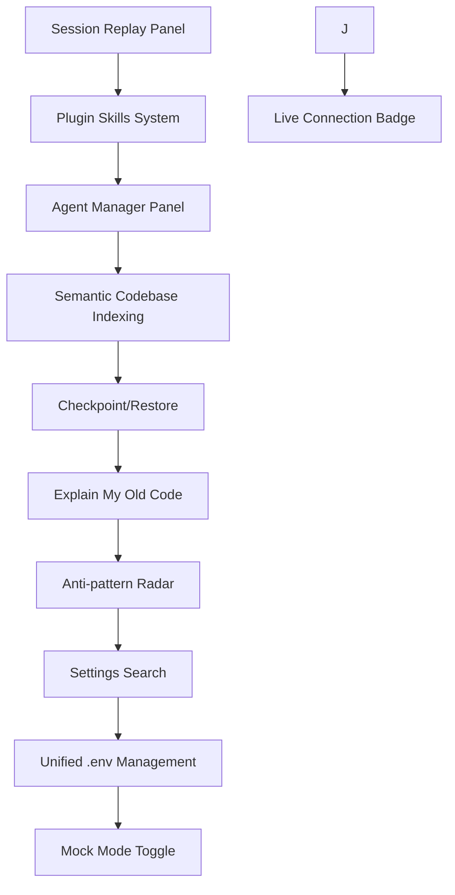

# HACKATHON_WIN_PLAN.md

## Executive Summary

RubberDuck Live is a privacy-first, agentic IntelliJ plugin with a FastAPI backend and Next.js dashboard. It delivers three pillars: AI-powered test generation, refactor suggestions, and a Socratic wellness META layer. Compared to Kilo Code, Roo Code, and Tabby, RubberDuck Live is strong on privacy, native JetBrains integration, and developer wellness, but lacks advanced agent orchestration, marketplace extensibility, and deep codebase indexing. This plan focuses on maximizing JetBrains judging criteria for the "Help the Developer" challenge, prioritizing IntelliJ polish and demo impact.

## Feature Gap Analysis (vs. Kilo, Roo, Tabby)

| Feature/Capability                | RubberDuck Live | Kilo Code | Roo Code | Tabby | Judging Impact |
|-----------------------------------|-----------------|-----------|----------|-------|----------------|
| MCP Server Marketplace            | No              | Yes       | No       | No    | Innovation     |
| Agent Manager (parallel sessions) | No              | Yes       | No       | No    | Technical Depth|
| Multi-model Routing               | Partial         | Yes       | No       | No    | Technical Depth|
| Changesets Versioning             | No              | Yes       | No       | No    | Polish         |
| Custom Modes/Skills               | No              | Yes       | Yes      | No    | Innovation     |
| Codebase Indexing (Vector DB)     | No              | No        | Yes      | Yes   | Technical Depth|
| Semantic Code Search              | No              | No        | Yes      | Yes   | Technical Depth|
| Task Orchestration/Subtasks       | No              | No        | Yes      | No    | Technical Depth|
| Checkpoint System                 | No              | No        | Yes      | No    | Technical Depth|
| Repo Context/Commit History       | No              | No        | No       | Yes   | Technical Depth|
| MoSCoW Feature Breakdown          | Partial         | No        | No       | No    | Polish         |
| Mermaid Architecture Diagrams     | Yes             | No        | No       | No    | Polish         |
| Wellness META Layer               | Yes             | No        | No       | No    | Innovation     |
| Privacy-first LLM Routing         | Yes             | No        | No       | No    | Innovation     |

## High-Impact Feature Proposals (IntelliJ Focus)

### Innovation
- **Plugin Skills System**: Allow users to enable/disable "skills" (e.g., custom refactorers, test generators) via plugin settings. [plugin/src/main/kotlin/com/rubberduck/live/services/SkillsManager.kt]
- **Session Replay**: Timeline replay of stuck moments and interventions in the tool window. [plugin/src/main/kotlin/com/rubberduck/live/ui/SessionReplayPanel.kt]

### Technical Depth
- **Agent Manager Panel**: Manage multiple agent sessions (e.g., parallel refactor/test runs) with isolated state. [plugin/src/main/kotlin/com/rubberduck/live/ui/AgentManagerPanel.kt]
- **Semantic Codebase Indexing**: Integrate a lightweight vector DB (e.g., Qdrant) for semantic search and context-aware suggestions. [plugin/src/main/kotlin/com/rubberduck/live/services/CodeIndexer.kt]
- **Checkpoint/Restore**: Save/restore plugin state for demo reliability. [plugin/src/main/kotlin/com/rubberduck/live/services/CheckpointService.kt]

### Polish
- **Settings Search**: Quick-search for plugin settings and actions. [plugin/src/main/kotlin/com/rubberduck/live/ui/SettingsSearch.kt]
- **Unified .env Management**: Single source of truth for all config, surfaced in plugin settings UI. [plugin/src/main/kotlin/com/rubberduck/live/services/EnvManager.kt]

### Developer Pain Relevance
- **Explain My Old Code**: Right-click action to summarize function + git blame context. [plugin/src/main/kotlin/com/rubberduck/live/actions/ExplainOldCodeAction.kt]
- **Anti-pattern Radar**: Highlight files with recurring stuck moments or anti-patterns in the project view. [plugin/src/main/kotlin/com/rubberduck/live/services/AntiPatternRadar.kt]

### Demo-ability
- **Mock Mode Toggle**: One-click switch to canned responses for bulletproof demo. [plugin/src/main/kotlin/com/rubberduck/live/settings/MockModeToggle.kt]
- **Live Connection Badge**: Real-time status indicator in tool window and editor. [plugin/src/main/kotlin/com/rubberduck/live/ui/StatusBadge.kt]

## Current Practice Review

**Strengths:**
- Native IntelliJ integration (actions, listeners, tool window, notifications)
- Privacy-first LLM routing (OpenAI/Ollama)
- Socratic wellness layer (unique among competitors)
- Robust demo script and preflight automation

**Needs Improvement:**
- No agent/session management UI
- No semantic codebase search or context-aware suggestions
- No session replay or intervention history in plugin
- No plugin-side skills/extensions system
- No quick settings search or unified config
- README polish pending

## Implementation Roadmap (IntelliJ Focus)

1. **Session Replay Panel** — Tool window timeline for stuck moments/interventions
2. **Plugin Skills System** — Modular skills, toggle in settings
3. **Agent Manager Panel** — Parallel agent session UI
4. **Semantic Codebase Indexing** — Integrate Qdrant or similar for search
5. **Checkpoint/Restore** — Save/restore plugin state
6. **Explain My Old Code** — Right-click action, LLM + git blame
7. **Anti-pattern Radar** — Project view highlights
8. **Settings Search** — Quick-search for plugin settings/actions
9. **Unified .env Management** — Plugin UI for config
10. **Mock Mode Toggle** — UI toggle for demo reliability
11. **Live Connection Badge** — Real-time status in tool window/editor

## Quick Wins (Pre-Judging)

- **Mock Mode Toggle**: UI toggle for canned responses [plugin/settings, backend/.env]
- **Live Connection Badge**: Status indicator in tool window [plugin/ui]
- **Settings Search**: Implement quick-search for plugin settings [plugin/ui]
- **README Polish**: Add credits, and clear feature table [README.md]

## Risk Assessment

| Proposal                  | Risk/Challenge                                      | Mitigation                                  |
|--------------------------|-----------------------------------------------------|----------------------------------------------|
| Plugin Skills System     | Plugin reloads, skill isolation                      | Use service loader pattern, clear API        |
| Agent Manager Panel      | State isolation, UI complexity                       | Limit to 2-3 parallel sessions for demo      |
| Semantic Codebase Index  | Indexing perf, LLM context window limits             | Index only open files or recent edits        |
| Checkpoint/Restore       | State serialization bugs                            | Limit scope to event log + settings          |
| Explain My Old Code      | Git blame API, LLM hallucination                     | Fallback to summary if blame fails           |
| Anti-pattern Radar       | False positives, UI clutter                          | Show only top-N patterns, allow dismiss      |
| Settings Search          | Settings API coverage                                | Index only visible settings for MVP          |
| Live Connection Badge    | WS reconnect edge cases                              | Use backend health endpoint, debounce UI     |

---

## Mermaid: High-Level Roadmap

---

## Estimated Effort Table

| Feature                   | Effort (relative) | Demo Impact |
|---------------------------|-------------------|-------------|
| Plugin Skills System      | Medium            | High        |
| Agent Manager Panel       | High              | Medium      |
| Semantic Codebase Index   | High              | High        |
| Checkpoint/Restore        | Medium            | Medium      |
| Explain My Old Code       | Medium            | High        |
| Anti-pattern Radar        | Medium            | Medium      |
| Settings Search           | Low               | Medium      |
| Unified .env Management   | Low               | Low         |
| Animated Demo GIFs        | Low               | High        |
| Live Connection Badge     | Low               | High        |

---

## References
- [`docs/ARCHITECTURE.md`](docs/ARCHITECTURE.md)
- [`docs/JUDGING_CHEATSHEET.md`](docs/JUDGING_CHEATSHEET.md)
- [`docs/DEMO_SCRIPT.md`](docs/DEMO_SCRIPT.md)
- Kilo Code, Roo Code, Tabby project docs

---

**This plan is focused on maximizing JetBrains judging criteria by delivering innovative, technically deep, and highly polished features in the IntelliJ plugin. Dashboard and VS Code improvements are out of scope for this hackathon submission.**
