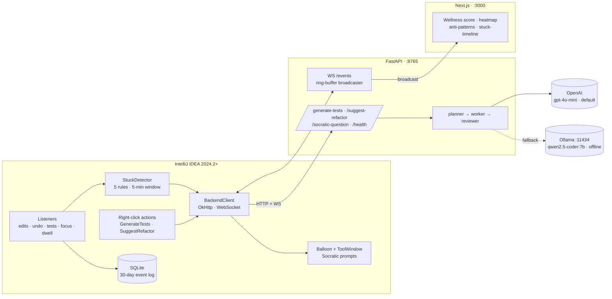

<p align="center">
  
</p>

<h1 align="center">🦆 RubberDuck Live</h1>
<p align="center"><em>Your IDE's pair programmer that watches you think.<br>AI-powered via OpenAI by default · swap to local Ollama for 100% offline.</em></p>

<p align="center">
  <a href="https://hackkosice.com"></a>
  <a href="#license"></a>
  
  
  
  
  
</p>

<p align="center">
  <!-- Will be replaced by docs/assets/hero.gif once recorded. See docs/assets/README.md -->
  
</p>

---

## Why

Every developer has been stuck staring at the same red squiggly for 10 minutes.
You rewrite the same loop four times. You *know* something is wrong.

**What if your IDE gently asked the right question at the right moment — instead of generating more code for you?**

**RubberDuck Live** is an **IntelliJ plugin + wellness dashboard** that:

- 🧪 **Generates tests** for any function with one right-click *(Pillar 1)*
- ♻️ **Suggests refactors** with an inline unified-diff preview *(Pillar 2)*
- 🦆 **Watches you think** — detects when you're stuck and nudges with a **Socratic question**, never an answer *(Pillar 3, the META layer)*

**Privacy-optional, pluggable LLM** — ships with OpenAI `gpt-4o-mini` as the default (zero local setup, just paste the key). Flip one env var and run entirely offline against Ollama `qwen2.5-coder:7b` on your machine. Same plugin, same endpoints, your choice of where the tokens go.

---

## The three pillars

<table>
<thead><tr>
  <th>🧪 Pillar 1 · Tests</th>
  <th>♻️ Pillar 2 · Refactor</th>
  <th>🦆 Pillar 3 · Wellness META</th>
</tr></thead>
<tbody>
<tr>
  <td></td>
  <td></td>
  <td></td>
</tr>
<tr>
  <td>Right-click any function → <strong>Generate Tests</strong>. A local planner-worker-reviewer pipeline emits a ready-to-run pytest / JUnit file, straight into the editor.</td>
  <td>Right-click selection → <strong>Suggest Refactor</strong>. Smell detector tags nested loops, magic numbers, and duplicate predicates; IntelliJ's native diff viewer renders the change.</td>
  <td>Passive listeners track edits, undos, test runs, caret dwell. A 5-rule <strong>StuckDetector</strong> fires a balloon with a <em>Socratic question</em> instead of an answer — and streams the moment to your personal wellness dashboard.</td>
</tr>
</tbody>
</table>

---

## How it works



Plugin ↔ backend ↔ dashboard traffic is loopback. The only outbound hop is the chosen LLM provider — and that hop disappears entirely when you select Ollama.

Full blueprint: [`docs/ARCHITECTURE.md`](docs/ARCHITECTURE.md).

---

## Quickstart (2 minutes)

```bash
git clone <this-repo> hack-kosice-2026 && cd hack-kosice-2026

# 1. Install everything (backend uv sync · dashboard npm install · gradle wrapper)
make install

# 2. Start the judging flow: backend (mock) + dashboard, coloured prefixes, Ctrl-C cleans up
make demo
# → backend:   http://127.0.0.1:8765
# → dashboard: http://localhost:3000

# 3. In another terminal, launch IntelliJ with the plugin loaded
make plugin-run
```

### Running with a real LLM

Pick **one** of:

**A. Cloud — OpenAI (default, zero local setup):**
```bash
cat >> backend/.env <<'EOF'
OPENAI_API_KEY=sk-...
EOF
make dev-live
# LLM_PROVIDER defaults to `openai` and OPENAI_MODEL defaults to `gpt-4o-mini`.
```

**B. Local — Ollama (100 % offline, privacy-first):**
```bash
ollama pull qwen2.5-coder:7b
make dev-local   # same as dev-live but pins LLM_PROVIDER=ollama
```

The provider is selected per-call by the backend. Same endpoints, same DTOs — only the dispatch changes. For self-hosted OpenAI-compatible servers (LM Studio, vLLM, Groq, Together), set `LLM_PROVIDER=openai_compatible` + `OPENAI_BASE_URL` in `backend/.env`. See [`backend/.env.example`](backend/.env.example) for the full list.

Prefer individual commands? See [`backend/README.md`](backend/README.md), [`dashboard/README.md`](dashboard/README.md), and [`plugin/README.md`](plugin/README.md).

### Windows

Install once:

- **JDK 21** (e.g., Eclipse Temurin) — set `JAVA_HOME` to its install dir.
- **Python 3.13** — `winget install Python.Python.3.13` or python.org.
- **Node 20+ LTS** — nodejs.org.
- **Git for Windows** — bundles Git Bash, which ships `make`.
- Optional: **Ollama for Windows** (ollama.ai) + `ollama pull qwen2.5-coder:7b`.

The orchestration is cross-platform: `scripts/kill_port.py` replaces the Unix-only `lsof`, and the macOS `java_home` lookup in the Makefile is guarded. Two paths:

**From Git Bash (recommended):** all standard targets work — `make install`, `make dev`, `make stop`, `make plugin-run`.

**From PowerShell or `cmd.exe`:** `make` isn't available — call the components directly:

```powershell
cd backend; uv run uvicorn src.main:app --host 127.0.0.1 --port 8765
cd dashboard; npm run dev
cd plugin; .\gradlew.bat runIde
```

---

## Demo

Full three-minute script, minute-by-minute: [`docs/DEMO_SCRIPT.md`](docs/DEMO_SCRIPT.md).

Five minutes before judging, run the preflight:

```bash
make demo-preflight
```

It checks 10 things — `OPENAI_API_KEY` present (or Ollama daemon up), ports free, plugin zip present, deps installed, dashboard seed, git state — and tells you go / no-go.

---

## Privacy & Security

- **Loopback-only inter-component traffic.** Plugin ↔ backend ↔ dashboard never leaves `127.0.0.1`. The only outbound request is the LLM API call, and it disappears entirely when you select `LLM_PROVIDER=ollama`.
- **No telemetry.** Zero analytics SDKs in plugin or dashboard.
- **Event log stays local.** SQLite under `$IDE_CONFIG_DIR/rubberduck-live/events.db`, 30-day retention, pruned nightly.
- **Path redaction is always on.** The plugin strips absolute paths before anything touches the network (`/Users/foo/proj/src/a.py` → `src/a.py`).
- **Code never touches the backend filesystem.** Generated tests come back as a JSON string; the plugin writes the file via the VFS.
- **CORS locked** to `localhost:3000` + `127.0.0.1:3000`.

Full threat model: [`docs/ARCHITECTURE.md` §11](docs/ARCHITECTURE.md#11-security--privacy).

---

## Project layout

```
hack-kosice-2026/
├── plugin/          # Kotlin · IntelliJ Platform 2024.2+
├── backend/         # Python 3.13 · FastAPI · httpx · OpenAI by default, Ollama fallback
├── dashboard/       # Next.js 16 · React 19 · Tailwind 4 · shadcn
├── docs/            # Architecture, demo script, judging cheatsheet, phase notes
├── scripts/         # dev.sh · demo-preflight.sh · kill_port.py (cross-platform port killer)
├── Makefile         # one-command orchestration (make help)
└── .env.example     # consolidated env reference
```

---

## Roadmap

What's **in** (MVP — shipped for judging):

- 3 right-click actions · 5 StuckDetector rules · live WS dashboard · OpenAI default + Ollama/OpenAI-compatible fallback chain · per-session ring buffer · SQLite plugin-side log · `DEMO_MOCK=1` fixture short-circuit for bulletproof demos.

What we'd build **next**:

1. **Team mode** — opt-in shared anti-pattern radar so squads can see which files are frustration hotspots.
2. **Session replay** — scrub the editor timeline, replay each stuck moment with the question that was asked.
3. **VSCode port** — same backend, new thin client.
4. **"Explain my old code"** — feed function + git-blame context to the LLM.
5. **Local vector memory of past stuck moments** — *"You solved something similar on Tuesday — here's the commit."*

Full list: [`docs/JUDGING_CHEATSHEET.md`](docs/JUDGING_CHEATSHEET.md).

---

## Credits

**Team ???** — *Hack Košice 2026 · JetBrains "Help the Developer" challenge.*

- 🔌  Plugin / IntelliJ Platform — `<Name>`
- ⚙️  Backend / agentic pipeline — `<Name>`
- 📊  Dashboard / UX — `<Name>`
- 🎬  Demo, design, pitch — `<Name>`

Built during Hack Košice 2026 — `docs/DEMO_SCRIPT.md` was timed to a hard 3:00.

---

## License

MIT. See `LICENSE` for details.
