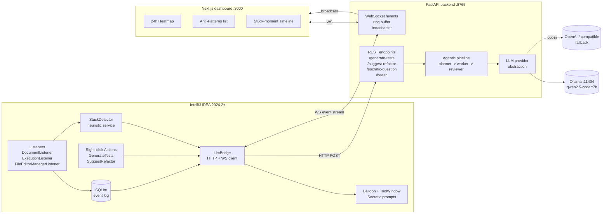

# RubberDuck Live — Architecture

Phase 1 technical blueprint. Every **[DECISION]** below is locked for downstream phases unless explicitly revisited.

---

## 1. System Overview



All traffic is loopback (`127.0.0.1`). No outbound network by default.

---

## 2. Component Breakdown

### 2.1 Plugin (Kotlin, IntelliJ Platform SDK) — `plugin/`

| Module | Responsibility | Key files |
| --- | --- | --- |
| `listeners/` | Subscribe to IDE events (doc edits, undo, test runs, file focus, caret dwell) and emit normalized `DeveloperEvent`s | `DocumentChangeListener.kt`, `TestExecutionListener.kt`, `FileFocusListener.kt`, `CaretDwellTracker.kt` |
| `services/EventCollector` | Application-level service. Batches events, writes to SQLite, forwards to `LlmBridge` WS | `EventCollector.kt` |
| `services/StuckDetector` | Rule engine over a rolling window of recent events; emits `STUCK_DETECTED` triggers | `StuckDetector.kt` |
| `services/LlmBridge` | Single HTTP/WS client to backend; request/response DTOs; reconnect logic | `LlmBridge.kt`, `Dtos.kt` |
| `actions/` | Right-click actions registered in `plugin.xml` | `GenerateTestsAction.kt`, `SuggestRefactorAction.kt` |
| `ui/` | Balloon notification, ToolWindow for Socratic dialog, settings panel | `SocraticBalloon.kt`, `RubberDuckToolWindow.kt`, `SettingsConfigurable.kt` |
| `storage/` | SQLite via `org.xerial:sqlite-jdbc`; schema migration on first run | `EventStore.kt` |

Threading **[DECISION]**: all IDE event capture runs on EDT, hands off to a single-threaded `Dispatchers.IO` coroutine scope for DB + HTTP. UI callbacks return via `invokeLater`.

### 2.2 Backend (FastAPI, Python ≥ 3.13) — `backend/`

| Module | Responsibility | Status |
| --- | --- | --- |
| `src/main.py` | App factory, CORS, router registration, WS route | **keep, trim root endpoint** |
| `src/settings.py` | Pydantic settings; add `LLM_PROVIDER`, `OLLAMA_BASE_URL`, `OLLAMA_MODEL`, drop hard OpenAI requirement | **modify** |
| `src/api/v1/endpoints/healthcheck.py` | `/health` with LLM probe | **extend** |
| `src/api/v1/endpoints/tests_endpoint.py` *(new)* | `POST /generate-tests` | **new** |
| `src/api/v1/endpoints/refactor_endpoint.py` *(new)* | `POST /suggest-refactor` | **new** |
| `src/api/v1/endpoints/socratic_endpoint.py` *(new)* | `POST /socratic-question` | **new** |
| `src/api/v1/endpoints/events_ws.py` *(new, replaces `websocket_handler.py`)* | `WS /events` ingest + broadcast | **new (reuse `WebSocketManager` pattern)** |
| `src/core/llm_provider.py` *(new)* | Provider abstraction: Ollama (default), OpenAI, OpenAI-compatible | **new** |
| `src/core/pipelines/` *(new)* | `test_pipeline.py`, `refactor_pipeline.py`, `socratic_pipeline.py` — thin planner→worker→reviewer orchestrations reusing the architect pattern | **new, reuses existing code** |
| `src/core/ring_buffer.py` *(new)* | In-memory bounded deque of last N `DeveloperEvent`s per client | **new** |

### 2.3 Dashboard (Next.js 16 App Router + Tailwind 4 + shadcn) — `dashboard/`

| Route / component | Responsibility |
| --- | --- |
| `app/page.tsx` | Landing page with live connection badge, 3 panels |
| `components/Heatmap.tsx` | 24 × 7 cell heatmap of edit density (Recharts or raw SVG) |
| `components/AntiPatternsList.tsx` | Top-N recurring patterns with counts + trend |
| `components/StuckTimeline.tsx` | Chronological list of stuck-moment cards |
| `hooks/useEventStream.ts` | WS client subscribing to `WS /events` (replaces `useArenaSocket`) |
| `lib/types.ts` | Mirrors backend `DeveloperEvent` schema |

Stripped: all `components/arena/*` and `utils/codeToPixels.ts`.

---

## 3. Event Model — `DeveloperEvent` **[DECISION]**

Canonical JSON shape emitted by the plugin and broadcast to the dashboard.

```json
{
  "event_id": "uuid-v4",
  "session_id": "uuid-v4-per-ide-launch",
  "ts": 1734518400123,
  "type": "EDIT | UNDO | REDO | TEST_RUN | FILE_FOCUS | CARET_DWELL | STUCK_DETECTED | INTERVENTION_SHOWN | INTERVENTION_ACCEPTED | INTERVENTION_DISMISSED",
  "file": "src/main/kotlin/com/acme/Foo.kt",
  "language": "kotlin",
  "payload": { "...": "type-specific, see below" }
}
```

Type-specific `payload` fields (only the fields listed are required; additional fields allowed and ignored by older consumers):

| `type` | Required `payload` fields | Example |
| --- | --- | --- |
| `EDIT` | `chars_added:int`, `chars_removed:int`, `line:int` | `{"chars_added":12,"chars_removed":0,"line":42}` |
| `UNDO` / `REDO` | `line:int` | `{"line":42}` |
| `TEST_RUN` | `test_name:string`, `outcome:"pass"\|"fail"\|"error"`, `duration_ms:int`, `failure_signature?:string` | `{"test_name":"test_fizz","outcome":"fail","duration_ms":132,"failure_signature":"AssertionError:expected 'Fizz' got '3'"}` |
| `FILE_FOCUS` | `previous_file?:string`, `duration_in_previous_ms?:int` | `{"previous_file":"Bar.kt","duration_in_previous_ms":8400}` |
| `CARET_DWELL` | `line:int`, `duration_ms:int`, `has_error_marker:bool` | `{"line":42,"duration_ms":95000,"has_error_marker":true}` |
| `STUCK_DETECTED` | `rule:string`, `confidence:float`, `window_events:int` | `{"rule":"undo_burst","confidence":0.9,"window_events":5}` |
| `INTERVENTION_*` | `intervention_id:string`, `kind:"socratic"\|"refactor"\|"tests"` | `{"intervention_id":"abc","kind":"socratic"}` |

**[DECISION]** Timestamps are epoch-millis ints (not ISO strings) to keep plugin↔backend cheap.

---

## 4. Plugin ↔ Backend API Contract **[DECISION]**

Base URL: `http://127.0.0.1:8765/api/v1`. All requests/responses are JSON. Errors use `{ "error": {"code": string, "message": string} }` with appropriate HTTP status.

### `POST /generate-tests`

Request:
```json
{
  "language": "python",
  "code": "def fizzbuzz(n): ...",
  "function_name": "fizzbuzz",
  "file_path": "src/fizz.py",
  "context_files": [
    { "path": "src/utils.py", "content": "..." }
  ]
}
```
Response:
```json
{
  "test_code": "import pytest\n...",
  "test_file_name": "test_fizz.py",
  "framework": "pytest",
  "reasoning": "Covers 0, 3, 5, 15, negative, and non-int."
}
```

### `POST /suggest-refactor`

Request:
```json
{
  "language": "python",
  "code": "def bad(...): ...",
  "file_path": "src/bad.py",
  "selection_range": { "start_line": 10, "end_line": 40 },
  "smell_hints": ["nested_loops", "magic_numbers"]
}
```
Response:
```json
{
  "refactored_code": "def good(...): ...",
  "diff_unified": "--- a/src/bad.py\n+++ b/src/bad.py\n@@ ...",
  "smells_detected": [
    { "type": "nested_loops", "line": 14, "description": "Triple-nested loop; extract inner to helper." },
    { "type": "magic_number", "line": 22, "description": "Replace 86400 with constant SECONDS_PER_DAY." }
  ],
  "reasoning": "Flattened loop, hoisted constants, extracted predicate."
}
```

### `POST /socratic-question`

Request:
```json
{
  "recent_events": [ { "... DeveloperEvent ...": true } ],
  "current_code": "def buggy(...): ...",
  "stuck_reason": "undo_burst"
}
```
Response:
```json
{
  "question": "You've rewritten this loop 4 times. What invariant are you trying to preserve?",
  "follow_ups": [
    "What is the loop's termination condition supposed to guarantee?",
    "Which inputs have you actually tested against?"
  ],
  "confidence": 0.82
}
```

### `GET /health`

```json
{
  "status": "ok",
  "llm_provider": "ollama",
  "llm_model": "qwen2.5-coder:7b",
  "llm_available": true
}
```

### `WS /events`

Bidirectional. Envelope **[DECISION]**:

```json
{ "type": "event | ack | broadcast | ping | pong | error",
  "timestamp": 1734518400123,
  "payload": { "...": "..." } }
```

- Plugin sends `{type:"event", payload: DeveloperEvent}`.
- Backend stores in per-session ring buffer and rebroadcasts `{type:"broadcast", payload: DeveloperEvent}` to all dashboard subscribers.
- Heartbeat: either side sends `ping` every 20 s; silence > 45 s triggers reconnect.
- Dashboard subscribes read-only; the first message it receives is a `{type:"broadcast", payload:{kind:"snapshot", events:[...last 500...]}}` replay.

---

## 5. StuckDetector Heuristics **[DECISION]**

All rules run on a rolling 5-minute sliding window of events in memory inside the plugin. Each rule emits a `STUCK_DETECTED` event with `rule`, `confidence`, and triggers at most **once per 60 s** (rate-limit to avoid nagging).

| Rule | Trigger condition | Confidence |
| --- | --- | --- |
| `undo_burst` | ≥ 4 `UNDO` events within 30 s on the same file | 0.9 |
| `repeated_failing_test` | Same `failure_signature` appears in ≥ 3 `TEST_RUN{outcome=fail}` within 5 min | 0.95 |
| `long_idle_on_error` | `CARET_DWELL.duration_ms ≥ 90000` with `has_error_marker=true` | 0.8 |
| `rapid_file_switching` | ≥ 6 distinct `FILE_FOCUS` files within 60 s with avg dwell < 8 s | 0.7 |
| `edit_thrash` *(bonus)* | `chars_added + chars_removed > 500` and net `|Δchars| < 20` in 60 s | 0.75 |

The plugin-side detector is the source of truth. The backend never infers "stuck" — it only reacts to `STUCK_DETECTED` events. This keeps the intervention loop local and fast.

---

## 6. Agentic Pipeline Reuse Plan

Existing pipeline is overbuilt for multi-file game generation. We strip it to a minimal **planner → worker → reviewer** shape per endpoint.

### Keep
- [`backend/src/core/architect_agent.py`](../backend/src/core/architect_agent.py) — prompt pattern; repurpose as lightweight `TestPlannerAgent` / `RefactorPlannerAgent` (one agent, one file, no multi-agent fan-out).
- [`backend/src/core/dynamic_worker.py`](../backend/src/core/dynamic_worker.py) — the "execute LLM with structured JSON output + retry" loop is exactly what we need for each endpoint.
- [`backend/src/core/reviewer.py`](../backend/src/core/reviewer.py) — becomes **SmellDetectorAgent** for refactor; also used to sanity-check generated tests compile.
- [`backend/src/api/v1/endpoints/websocket_handler.py`](../backend/src/api/v1/endpoints/websocket_handler.py) `WebSocketManager` class — copy verbatim into `events_ws.py`, drop the `handle_build_project` logic.
- JSON-retry scaffolding from [`backend/src/core/architect_pipeline.py`](../backend/src/core/architect_pipeline.py) (`_validate_generated_files`, retry loop) — generalize into a `llm_json_call(prompt, schema, max_retries)` helper.

### Repurpose
| Existing role | New role | Endpoint |
| --- | --- | --- |
| `ArchitectAgent` (multi-agent planner) | `TestPlanner` — decide test framework, list test cases | `/generate-tests` |
| `DynamicWorkerAgent` (file generator) | `TestWriter` — emit one test file | `/generate-tests` |
| `CodeReviewer` | `SmellDetector` — tag smells + produce diff | `/suggest-refactor` |
| `ArchitectAgent` | `SocraticCoach` — one-shot prompt, no fan-out | `/socratic-question` |

### Deprecate / Delete
- [`backend/src/core/filesystem_writer.py`](../backend/src/core/filesystem_writer.py) — plugin writes files, not backend.
- [`backend/src/core/code_executor.py`](../backend/src/core/code_executor.py), [`backend/src/core/testing_agent.py`](../backend/src/core/testing_agent.py), [`backend/src/core/builder.py`](../backend/src/core/builder.py), [`backend/src/core/doc_writer.py`](../backend/src/core/doc_writer.py), [`backend/src/core/pipeline.py`](../backend/src/core/pipeline.py) — game-generation specific, not needed for MVP.
- [`backend/src/api/v1/endpoints/project_router.py`](../backend/src/api/v1/endpoints/project_router.py), [`backend/src/api/v1/helpers.py`](../backend/src/api/v1/helpers.py) (project zip logic) — delete.
- `generated_projects/` workflow — N/A, delete if present.
- `src/models/build.py`, `src/utils/pipeline_agent.py` — delete.
- Root `/` endpoint in `main.py` — replace with minimal `{name: "RubberDuck Live", version}`.

### LLM call hardening
Every agent call goes through a single helper that: renders the prompt, requests strict JSON, validates with a Pydantic model, retries up to 3× on `JSONDecodeError` or schema-mismatch, and falls back to a "degraded" canned response on the 4th failure so the demo never hangs.

---

## 7. Dashboard Data Model

The dashboard is stateless — it derives everything from the live WS event stream (seeded by the initial snapshot replay).

### Heatmap buckets
```ts
type HeatmapCell = {
  hour: number;       // 0..23, local time
  dow: number;        // 0..6, 0=Mon
  edit_count: number;
  stuck_count: number;
  intensity: number;  // normalized 0..1 for coloring
};
```
Computed client-side by bucketing `EDIT` and `STUCK_DETECTED` events.

### Anti-pattern entry
```ts
type AntiPattern = {
  id: string;                  // e.g., "undo_burst:Foo.kt:loop"
  label: string;               // "Undo thrashing on nested loops"
  rule: string;                // maps to StuckDetector rule
  occurrences: number;
  last_seen_ts: number;
  representative_file: string;
};
```
Aggregation: group `STUCK_DETECTED` events by `(rule, file)`, count, sort desc.

### Stuck-moment timeline entry
```ts
type StuckMoment = {
  event_id: string;
  ts: number;
  file: string;
  rule: string;
  confidence: number;
  socratic_question?: string;   // filled if an INTERVENTION_SHOWN followed
  outcome?: "accepted" | "dismissed";
};
```

---

## 8. LLM Provider Strategy **[DECISION]**

Selection order (first available wins):

1. **Ollama** (default) — `http://127.0.0.1:11434`, model `qwen2.5-coder:7b`. Probed at `/health` via `GET /api/tags`.
2. **OpenAI-compatible** — any `OPENAI_BASE_URL` + `OPENAI_API_KEY` env. Enables LM Studio, vLLM, Together, Groq, etc.
3. **OpenAI** — pure OpenAI if only `OPENAI_API_KEY` is set (no base URL).

Config (env, `backend/.env`):
```
LLM_PROVIDER=ollama            # ollama | openai_compatible | openai
OLLAMA_BASE_URL=http://127.0.0.1:11434
OLLAMA_MODEL=qwen2.5-coder:7b
OPENAI_BASE_URL=
OPENAI_API_KEY=
OPENAI_MODEL=gpt-4o-mini
```

Implementation: one `LlmProvider` interface with `async def chat_json(messages, schema) -> dict`. Adapters wrap `httpx.AsyncClient` for Ollama's `/api/chat` (with `format: "json"`) and OpenAI's `/v1/chat/completions` (with `response_format: {type:"json_object"}`). The existing `langchain_openai` dependency is **dropped** — swap to raw `httpx` to eliminate cold-start latency and keep the dependency surface small.

---

## 9. Local Storage

### Plugin SQLite **[DECISION]**
Located at `$IDE_CONFIG_DIR/rubberduck-live/events.db`. Single table:

```sql
CREATE TABLE events (
  id           TEXT PRIMARY KEY,     -- event_id uuid
  session_id   TEXT NOT NULL,
  ts           INTEGER NOT NULL,     -- epoch millis
  type         TEXT NOT NULL,
  file         TEXT,
  payload_json TEXT NOT NULL         -- full JSON blob
);
CREATE INDEX idx_events_ts   ON events(ts);
CREATE INDEX idx_events_type ON events(type);
```
Retention: keep last 30 days; nightly prune on first event of the day.

### Backend
**No DB.** Per-connection in-memory ring buffer (`collections.deque(maxlen=500)`) keyed by `session_id`. Survives as long as the backend process. This is fine for MVP — the plugin is the durable store.

---

## 10. Port Allocation **[DECISION]**

| Service | Port | Bind |
| --- | --- | --- |
| FastAPI backend | **8765** | `127.0.0.1` |
| Next.js dashboard | **3000** | `127.0.0.1` |
| Ollama | **11434** | `127.0.0.1` (default) |

Backend CORS allows `http://localhost:3000` and `http://127.0.0.1:3000` only.

---

## 11. Security & Privacy

- **No outbound network by default.** Backend only talks to Ollama on loopback. Cloud LLM requires the user flipping `LLM_PROVIDER` in settings **and** acknowledging a one-time consent dialog in the plugin settings UI.
- **No telemetry.** No analytics SDKs in plugin or dashboard.
- **Event log stays on disk in the IDE config dir** (user-local, not synced).
- **Code never touches the filesystem on the backend.** `POST /generate-tests` returns the test body; the plugin writes it via VFS.
- **Redaction hook**: plugin strips absolute paths and replaces them with workspace-relative paths before sending (`/Users/foo/proj/src/a.py` → `src/a.py`).
- **Opt-in sharing toggle**: off by default; when on, dashboard is accessible but still localhost only.

---

## 12. Risks & Mitigations

| # | Risk | Mitigation |
| --- | --- | --- |
| 1 | Ollama cold-start (first request 10–30 s on CPU-only machines) | Warm-up call during plugin startup; show "Warming up LLM…" toast; have canned pre-baked responses behind a `DEMO_MOCK=1` env flag for the live demo. |
| 2 | LLM JSON parsing fragility (especially 7B models) | Strict JSON mode (`format:"json"` for Ollama, `response_format` for OpenAI), Pydantic validation, 3× retry, schema-lenient fallback prompt on second failure. |
| 3 | IntelliJ EDT threading violations | All listener callbacks are thin; heavy work dispatched to a dedicated coroutine scope; all UI updates wrapped in `ApplicationManager.getApplication().invokeLater {}`. |
| 4 | WebSocket reconnect storms when backend is down | Exponential backoff starting 1 s, max 30 s, with jitter; visible connection badge in ToolWindow; events queue locally in SQLite while disconnected. |
| 5 | Plugin sandbox / `runIde` classpath issues with SQLite JDBC | Bundle `org.xerial:sqlite-jdbc` in plugin runtime deps; validate on `./gradlew runIde` in CI before Phase 5. |
| 6 | Demo time pressure (3 min is tight) | `DEMO_MOCK=1` short-circuits LLM calls to pre-cached responses; keyboard-macro-driven "stuck" simulation; dashboard pre-populated with yesterday's events. |
| 7 | Generated tests import the function under the wrong path | Plugin supplies `file_path` and `function_name`; backend prompt emits `from <module> import <fn>` using the supplied path (language-aware). |
| 8 | IDE-specific API drift between 2024.2 and 2025.x | Target `sinceBuild=242` / `untilBuild=""`; use stable Platform APIs only (no internal `com.intellij.openapi.internal.*`). |

---

## 13. Phase Handoff Checklist

### Phase 2 (Backend implementation) receives
- Locked endpoint paths, request/response schemas (§4), error envelope.
- LLM provider interface + env var names (§8).
- Reuse plan mapping existing files to new roles (§6).
- Ring buffer + WS envelope spec (§4).
- Port 8765 and CORS origins (§10).

### Phase 3 (Plugin implementation) receives
- `DeveloperEvent` schema (§3), SQLite DDL (§9).
- StuckDetector rule table with thresholds (§5).
- Backend base URL `http://127.0.0.1:8765/api/v1` and all DTO shapes (§4).
- Threading rules (§2.1).
- Redaction requirement (§11).

### Phase 4 (Dashboard implementation) receives
- WS envelope + snapshot replay semantics (§4).
- TS types for `DeveloperEvent`, `HeatmapCell`, `AntiPattern`, `StuckMoment` (§3, §7).
- Stripping list (arena components) and retained shadcn primitives (§2.3).
- Port 3000 and WS URL `ws://127.0.0.1:8765/api/v1/events` (§10).

### Phase 5 (Polish) receives
- Mock-mode flag `DEMO_MOCK=1` contract from Risks §12.
- Demo script inputs from [`DEMO_SCRIPT.md`](DEMO_SCRIPT.md).

---

## 14. Out of Scope (Phase 1–5)

- VSCode port.
- Team / leaderboard mode.
- Cloud-hosted backend.
- Vector store of past stuck moments.
- Git-blame powered "explain my old code" (SHOULD, not MUST).

These are mentioned in the judging cheatsheet under "What we'd build next" only.
