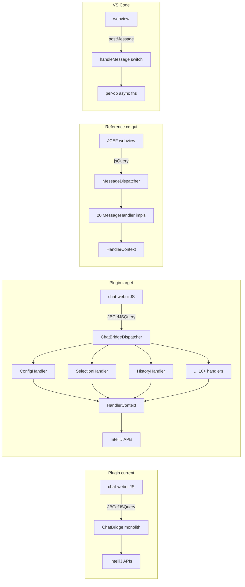

# Chat Plugin Audit V2 — RubberDuck Live (IntelliJ)

**Date:** 2026-04-19
**Scope:** [`plugin/`](../plugin) IntelliJ chat integration, cross-referenced against the sibling [`vscode-extension/`](../vscode-extension) implementation and the external [`external-jetbrain/`](../external-jetbrain) reference plugin (`jetbrains-cc-gui` / Claude Code GUI).
**Supersedes:** _(no prior `JETBRAINSCCGUI_AUDIT.md` found on disk — only a stale VS Code tab reference.)_

---

## 0. TL;DR

| Area | State | Severity |
|---|---|---|
| **Dispatcher/handler refactor** | ❌ **Not done.** Files listed in VS Code Open Tabs ([`ChatBridgeDispatcher.kt`](../plugin/src/main/kotlin/com/rubberduck/live/chat/bridge/ChatBridgeDispatcher.kt:1), 13 handlers, 2 test files) **do not exist on disk.** The monolith [`ChatBridge.kt`](../plugin/src/main/kotlin/com/rubberduck/live/chat/ChatBridge.kt:71) still owns all ~25 bridge methods. | 🔴 **HIGH** |
| **Bridge unit-test coverage** | ❌ No tests exist for the bridge at all. Only [`StuckDetectorTest.kt`](../plugin/src/test/kotlin/) is present. | 🔴 **HIGH** |
| **Feature parity vs VS Code** | ✅ Parity achieved (all ~25 bridge ops implemented in `ChatBridge.kt`). | 🟢 none |
| **Feature gaps vs cc-gui** | ⚠️ Missing: Rewind, Prompt Enhancer, font/language sync, webview watchdog, JCEF fallback with registry auto-flip, per-tab sessions. | 🟡 **MEDIUM** |
| **Robustness (EDT, rate-limit, size-cap)** | ⚠️ Clipboard/notify/readFile paths don't enforce rate/size limits cc-gui applies. | 🟡 **MEDIUM** |
| **UI/UX polish** | ✅ Good (session rail, slash/@ menus, streaming, edit cards). | 🟢 none |

**Headline finding:** the task premise ("recently refactored into dispatcher + per-action handlers") is **false on disk**. The VS Code Open Tabs list is phantom — the refactor is aspirational, not complete. This audit treats the refactor as the #1 pending item.

---

## 1. Evidence summary

### 1.1 Phantom files (listed in Open Tabs, not on disk)

All of the following returned `ENOENT`:

- [`plugin/src/main/kotlin/com/rubberduck/live/chat/bridge/ChatBridgeDispatcher.kt`](../plugin/src/main/kotlin/com/rubberduck/live/chat/bridge/ChatBridgeDispatcher.kt:1)
- [`plugin/src/main/kotlin/com/rubberduck/live/chat/bridge/ChatBridgeHandler.kt`](../plugin/src/main/kotlin/com/rubberduck/live/chat/bridge/ChatBridgeHandler.kt:1)
- `plugin/src/main/kotlin/com/rubberduck/live/chat/bridge/handlers/` — 13 files: `ConfigHandler.kt`, `SelectionHandler.kt`, `OpenFilesHandler.kt`, `FileReadHandler.kt`, `InsertHandler.kt`, `ReplaceHandler.kt`, `ClipboardHandler.kt`, `ModelsHandler.kt`, `ModelPersistHandler.kt`, `HistoryHandler.kt`, `NotifyHandler.kt`, `ReadyHandler.kt`, `LogHandler.kt`
- `plugin/src/test/kotlin/com/rubberduck/live/chat/bridge/ChatBridgeDispatcherTest.kt`
- `plugin/src/test/kotlin/com/rubberduck/live/chat/bridge/HandlersTest.kt`

### 1.2 Actual plugin chat sources

```text
plugin/src/main/kotlin/com/rubberduck/live/chat/
├── ChatBridge.kt            ← monolith (~800 lines), owns all bridge ops
├── ChatBrowserPanel.kt      ← JCEF host + theme sync
├── ChatPanelRegistry.kt     ← project service, weak refs
├── ChatResourceHandler.kt   ← extract webui/chat/* → temp dir
├── SessionFileResolver.kt   ← redacted path → VirtualFile w/ project gate
├── SessionStore.kt          ← per-session JSON, atomic writes
└── actions/                 ← thin dispatchers → executeContextAction(name)
```

`ChatBridge` structure (current):

| Line range | Method group |
|---|---|
| [`114-121`](../plugin/src/main/kotlin/com/rubberduck/live/chat/ChatBridge.kt:114) | `buildBootstrapScript()` |
| [`125-155`](../plugin/src/main/kotlin/com/rubberduck/live/chat/ChatBridge.kt:125) | `register(name, handler)` — direct `JBCefJSQuery` fan-out |
| [`176-395`](../plugin/src/main/kotlin/com/rubberduck/live/chat/ChatBridge.kt:176) | Context ops (`getConfig`, `getSelection`, `getOpenFiles`, `getDiagnostics`, `readFile`, `pickFile`, `setModel`, `insertAtCursor`, `replaceSelection`, `copyToClipboard`, `listSkills`, `getSkillBody`, `listModels`) |
| [`402-453`](../plugin/src/main/kotlin/com/rubberduck/live/chat/ChatBridge.kt:402) | History ops (`saveHistory`, `loadSession`, `deleteSession`, `renameSession`) |
| [`455-490`](../plugin/src/main/kotlin/com/rubberduck/live/chat/ChatBridge.kt:455) | Misc (`logMessage`, `notifyUser`, `onReady`) |
| [`516-629`](../plugin/src/main/kotlin/com/rubberduck/live/chat/ChatBridge.kt:516) | Edit ops (`applyEdit`, `rejectEdit`, `emitIntervention`) |
| [`653-745`](../plugin/src/main/kotlin/com/rubberduck/live/chat/ChatBridge.kt:653) | Search (`searchFiles`, `searchSemantic`) |

All ~25 ops live in one class. There is no dispatcher, no handler interface, no per-action unit test.

### 1.3 Reference architecture (cc-gui)

[`MessageDispatcher.java`](../external-jetbrain/src/main/java/com/github/claudecodegui/handler/core/MessageDispatcher.java:10):

```java
public boolean dispatch(String type, String content) {
    for (MessageHandler h : handlers) if (h.handle(type, content)) return true;
    return false;
}
```

[`MessageHandler.java`](../external-jetbrain/src/main/java/com/github/claudecodegui/handler/core/MessageHandler.java:7) — 2-method interface (`handle(type,content) → boolean`, `getSupportedTypes() → String[]`).
[`BaseMessageHandler.java`](../external-jetbrain/src/main/java/com/github/claudecodegui/handler/core/BaseMessageHandler.java:7) — protected `context`, `callJavaScript`, `escapeJs`, `executeJavaScript`, `matchesType`.
[`HandlerContext.java`](../external-jetbrain/src/main/java/com/github/claudecodegui/handler/core/HandlerContext.java:15) — shared `project`, `sdkBridge`, `settings`, `jsCallback` + volatile `session`/`browser`/`model`/`provider` + `executeJavaScriptOnEDT(...)`.
[`ChatWindowDelegate.initializeHandlers()`](../external-jetbrain/src/main/java/com/github/claudecodegui/ui/ChatWindowDelegate.java:222) registers ~20 handlers: `ProviderHandler`, `McpServerHandler`, `CodexMcpServerHandler`, `SkillHandler`, `FileHandler`, `SettingsHandler`, `SessionHandler`, `FileExportHandler`, `DiffHandler`, `PromptEnhancerHandler`, `AgentHandler`, `PromptHandler`, `TabHandler`, `RewindHandler`, `UndoFileHandler`, `DependencyHandler`, `ClipboardHandler`, `WindowEventHandler`, `PermissionHandler`, `HistoryHandler`.

### 1.4 VS Code parity (gold-standard dispatcher shape)

[`chatWebviewProvider.ts`](../vscode-extension/src/ui/chatWebviewProvider.ts:232) dispatches through a single `handleMessage(msg)` switch with per-op async functions (`getConfig`, `applyEdit`, `saveHistory`, `searchSemantic`, etc.). Shape-wise it already matches what we want for the plugin.

---

## 2. Architecture comparison



---

## 3. Findings by severity

### 🔴 HIGH

**H1. Dispatcher refactor not done** — see §1.1, §1.2. Blocks testability, code navigation, and feature addition. The Open Tabs list misrepresents reality.

**H2. No bridge unit tests** — [`plugin/src/test/kotlin/`](../plugin/src/test/kotlin/) contains only `StuckDetectorTest.kt`. Zero coverage for `saveHistory`, `applyEdit`, `searchSemantic`, session atomic writes, `SessionFileResolver` project-gate. Regression risk is unbounded.

**H3. Open Tabs vs disk drift** — the IDE tab state references 17 non-existent files. Anyone opening this workspace sees phantom files and assumes work is done. Either the files must be created (refactor) or the tabs pruned.

### 🟡 MEDIUM

**M1. Missing Rewind feature** — cc-gui [`RewindHandler.java`](../external-jetbrain/src/main/java/com/github/claudecodegui/handler/RewindHandler.java:17) exposes `rewind_files` which restores file state to a prior message snapshot. Our UI already has [`rewindToMessage(msgId)`](../chat-webui/app.js:1703) in `app.js` but the plugin bridge has no backend; the UI only updates transcript text.

**M2. No webview watchdog / recreate** — cc-gui [`WebviewInitializer.reloadWebview(reason)`](../external-jetbrain/src/main/java/com/github/claudecodegui/ui/WebviewInitializer.java:565) + `recreateWebview(reason)` handle hung JCEF. [`ChatBrowserPanel.kt`](../plugin/src/main/kotlin/com/rubberduck/live/chat/ChatBrowserPanel.kt:44) has no recovery path; a stuck JCEF tab stays stuck until the project reopens.

**M3. Clipboard/Notify robustness** — cc-gui [`ClipboardHandler.java`](../external-jetbrain/src/main/java/com/github/claudecodegui/handler/ClipboardHandler.java:19) rate-limits to 200 ms and caps 10 MB; our [`ChatBridge.copyToClipboard`](../plugin/src/main/kotlin/com/rubberduck/live/chat/ChatBridge.kt:335) has neither, and [`notifyUser`](../plugin/src/main/kotlin/com/rubberduck/live/chat/ChatBridge.kt:455) does no length cap. A runaway UI loop could OOM the EDT message queue.

**M4. `readFile` path traversal gate is weak** — [`readFile`](../plugin/src/main/kotlin/com/rubberduck/live/chat/ChatBridge.kt:254) accepts absolute paths without re-checking project containment via `ProjectFileIndex` (unlike [`SessionFileResolver`](../plugin/src/main/kotlin/com/rubberduck/live/chat/SessionFileResolver.kt:47)). Add a VFS gate equivalent to the resolver.

### 🟢 LOW (feature parity-with-cc-gui wishlist)

**L1. Prompt Enhancer** — [`PromptEnhancerHandler.java`](../external-jetbrain/src/main/java/com/github/claudecodegui/handler/PromptEnhancerHandler.java:39) AI-rewrites the composer text with editor context. Nice-to-have; requires backend prompt route.
**L2. Per-tab sessions** — cc-gui stores per-tab session state via [`TabStateService`](../external-jetbrain/src/main/java/com/github/claudecodegui/settings/TabStateService.java). Our tool window is single-tab chat; N/A until we add multi-tab.
**L3. Font/language sync injection** — cc-gui injects IDE font + locale into the webview ([`WebviewInitializer`](../external-jetbrain/src/main/java/com/github/claudecodegui/ui/WebviewInitializer.java:79)). We sync theme only ([`ChatBrowserPanel.setupThemeListener`](../plugin/src/main/kotlin/com/rubberduck/live/chat/ChatBrowserPanel.kt:133)).
**L4. JCEF unsupported fallback w/ registry auto-flip** — partial: [`buildJcefUnsupportedFallback`](../plugin/src/main/kotlin/com/rubberduck/live/chat/ChatBrowserPanel.kt:153) shows a label, but doesn't flip `ide.browser.jcef.out-of-process.enabled` automatically like cc-gui does.
**L5. Skill import/delete/toggle from webview** — cc-gui [`SkillHandler.java`](../external-jetbrain/src/main/java/com/github/claudecodegui/handler/SkillHandler.java:30) supports `import_skill`, `delete_skill`, `toggle_skill`, `open_skill`. Our bridge only has `listSkills` + `getSkillBody` ([`ChatBridge:340-370`](../plugin/src/main/kotlin/com/rubberduck/live/chat/ChatBridge.kt:340)).
**L6. History deep-search & favorites** — cc-gui [`HistoryHandler`](../external-jetbrain/src/main/java/com/github/claudecodegui/handler/history/HistoryHandler.java:13) supports `toggle_favorite`, `update_title`, `deep_search_history`, `export_session`. Our [`SessionStore`](../plugin/src/main/kotlin/com/rubberduck/live/chat/SessionStore.kt:60) has no favorites/search.

---

## 4. Bridge surface inventory (current plugin)

| Bridge op | Line | Returns | Risk |
|---|---|---|---|
| `getConfig` | [176](../plugin/src/main/kotlin/com/rubberduck/live/chat/ChatBridge.kt:176) | JsonObject | low |
| `getSelection` | [193](../plugin/src/main/kotlin/com/rubberduck/live/chat/ChatBridge.kt:193) | Json/null | low |
| `getOpenFiles` | [210](../plugin/src/main/kotlin/com/rubberduck/live/chat/ChatBridge.kt:210) | JsonArray | low |
| `getDiagnostics` | [226](../plugin/src/main/kotlin/com/rubberduck/live/chat/ChatBridge.kt:226) | JsonArray | low |
| `readFile` | [254](../plugin/src/main/kotlin/com/rubberduck/live/chat/ChatBridge.kt:254) | Json/null | **M4** |
| `pickFile` | [276](../plugin/src/main/kotlin/com/rubberduck/live/chat/ChatBridge.kt:276) | Json/null | low |
| `setModel` | [300](../plugin/src/main/kotlin/com/rubberduck/live/chat/ChatBridge.kt:300) | bool | low |
| `insertAtCursor` | [312](../plugin/src/main/kotlin/com/rubberduck/live/chat/ChatBridge.kt:312) | bool | low |
| `replaceSelection` | [322](../plugin/src/main/kotlin/com/rubberduck/live/chat/ChatBridge.kt:322) | bool | low |
| `copyToClipboard` | [335](../plugin/src/main/kotlin/com/rubberduck/live/chat/ChatBridge.kt:335) | bool | **M3** |
| `listSkills` / `getSkillBody` | [340](../plugin/src/main/kotlin/com/rubberduck/live/chat/ChatBridge.kt:340), [357](../plugin/src/main/kotlin/com/rubberduck/live/chat/ChatBridge.kt:357) | Json | **L5** |
| `listModels` | [372](../plugin/src/main/kotlin/com/rubberduck/live/chat/ChatBridge.kt:372) | JsonArray | low |
| `saveHistory` | [402](../plugin/src/main/kotlin/com/rubberduck/live/chat/ChatBridge.kt:402) | JsonObject | low |
| `listSessions` / `loadSession` / `deleteSession` / `renameSession` | [~410-434](../plugin/src/main/kotlin/com/rubberduck/live/chat/ChatBridge.kt:410) | Json | **L6** |
| `logMessage` | [450](../plugin/src/main/kotlin/com/rubberduck/live/chat/ChatBridge.kt:450) | bool | low |
| `notifyUser` | [455](../plugin/src/main/kotlin/com/rubberduck/live/chat/ChatBridge.kt:455) | bool | **M3** |
| `onReady` | [487](../plugin/src/main/kotlin/com/rubberduck/live/chat/ChatBridge.kt:487) | bool | low |
| `applyEdit` | [516](../plugin/src/main/kotlin/com/rubberduck/live/chat/ChatBridge.kt:516) | JsonObject | low |
| `rejectEdit` | [585](../plugin/src/main/kotlin/com/rubberduck/live/chat/ChatBridge.kt:585) | bool | low |
| `emitIntervention` | [612](../plugin/src/main/kotlin/com/rubberduck/live/chat/ChatBridge.kt:612) | bool | low |
| `searchFiles` | [653](../plugin/src/main/kotlin/com/rubberduck/live/chat/ChatBridge.kt:653) | JsonArray | low |
| `searchSemantic` | [723](../plugin/src/main/kotlin/com/rubberduck/live/chat/ChatBridge.kt:723) | JsonArray | low |

**Missing (vs cc-gui/UI expectation):** `rewindFiles`, `importSkill`, `deleteSkill`, `toggleSkill`, `enhancePrompt`, `toggleFavorite`, `deepSearchHistory`, `exportSession`.

---

## 5. Cross-reference matrix

| Feature | Plugin (Kotlin) | VS Code | cc-gui |
|---|---|---|---|
| Dispatcher pattern | ❌ monolith | ✅ switch + fns | ✅ `MessageDispatcher` |
| Per-op unit tests | ❌ | ⚠️ partial | ✅ |
| `saveHistory` atomic write | ✅ [`SessionStore.writeAtomic`](../plugin/src/main/kotlin/com/rubberduck/live/chat/SessionStore.kt:229) | ✅ [`writeSessionAtomic`](../vscode-extension/src/ui/chatWebviewProvider.ts:615) | ✅ |
| Semantic search (BM25) | ✅ [`CodeIndexer`](../plugin/src/main/kotlin/com/rubberduck/live/services/CodeIndexer.kt:54) | ✅ lazy prime | ✅ backend |
| Apply-edit w/ diff preview | ✅ `DiffApplier` | ✅ `vscode.diff` | ✅ |
| Theme sync | ✅ | ✅ | ✅ |
| Font/language sync | ❌ | N/A | ✅ |
| Webview watchdog/recreate | ❌ | N/A | ✅ |
| Rewind files | ❌ | ❌ | ✅ |
| Prompt enhancer | ❌ | ❌ | ✅ |
| Skill CRUD from webview | ⚠️ read-only | ❌ | ✅ |
| Per-tab sessions | ❌ (single-tab) | N/A | ✅ |
| Clipboard rate/size limit | ❌ | N/A (VS Code API) | ✅ |

---

## 6. Testability blockers

The monolith makes unit testing painful:

1. `ChatBridge` constructor binds directly to `JBCefBrowser` + `Project` + `CefRouter`, so instantiating it requires a live JCEF. A handler interface would allow pure-function tests on the op logic alone.
2. `JBCefJSQuery.create(...)` is called per-op in [`register()`](../plugin/src/main/kotlin/com/rubberduck/live/chat/ChatBridge.kt:125) — testing the routing behavior requires faking JCEF. With a dispatcher, the routing map is a plain `Map<String, Handler>` trivially assertable.
3. There is no seam for injecting a fake `SessionStore`, fake `CodeIndexer`, fake `SkillsManager`.

---

## 7. Risk register

| ID | Risk | Trigger | Mitigation |
|---|---|---|---|
| R1 | Regression on any bridge op edit | No tests | Refactor + add unit tests (Phase 1) |
| R2 | OOM from runaway `notifyUser`/`copyToClipboard` | UI bug or malicious page | Rate-limit + size-cap in handler base (Phase 1) |
| R3 | Path traversal via `readFile` | Crafted redacted path | ProjectFileIndex gate (Phase 1) |
| R4 | Stuck JCEF blocks user | Renderer crash | Watchdog + recreate (Phase 2) |
| R5 | Phantom files confuse contributors | IDE state drift | Commit refactor OR prune tabs (Phase 1) |

---

## 8. Recommendation

Proceed with a **three-phase plan** (see companion [`CHAT_PLUGIN_IMPROVEMENT_PLAN.md`](./CHAT_PLUGIN_IMPROVEMENT_PLAN.md)):

1. **Phase 1 — Refactor + harden** (resolves H1, H2, H3, M3, M4, R1, R2, R3, R5).
2. **Phase 2 — Robustness parity** (M2, L3, L4 → R4).
3. **Phase 3 — Feature parity with cc-gui** (M1, L1, L5, L6).

Phase 1 is the unblocker; nothing else should ship before it.
