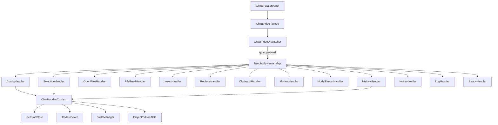
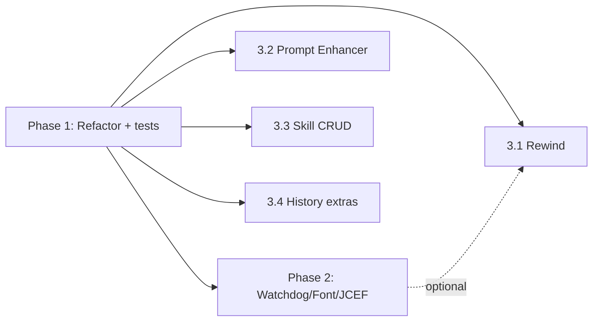

# Chat Plugin Improvement Plan — RubberDuck Live (IntelliJ)

**Date:** 2026-04-19
**Companion to:** [`CHAT_PLUGIN_AUDIT_V2.md`](./CHAT_PLUGIN_AUDIT_V2.md)
**Execution model:** three phases, each delegated as a separate Code-mode subtask. Phase 1 is **blocking** — Phases 2 & 3 must not start until Phase 1 lands on `main` with green tests.

---

## Guiding principles

1. **No behavior change in Phase 1.** Refactor is a pure move — the webview contract (`window.rubberduck.*`) and on-disk session format must stay byte-identical.
2. **Tests ride with code.** Every handler extracted in Phase 1 gets a dedicated unit test in the same PR. No exceptions.
3. **Borrow, don't fork.** Reuse cc-gui's shapes ([`MessageDispatcher`](../external-jetbrain/src/main/java/com/github/claudecodegui/handler/core/MessageDispatcher.java:10) / [`MessageHandler`](../external-jetbrain/src/main/java/com/github/claudecodegui/handler/core/MessageHandler.java:7) / [`HandlerContext`](../external-jetbrain/src/main/java/com/github/claudecodegui/handler/core/HandlerContext.java:15)) — translated to idiomatic Kotlin.
4. **VS Code parity is a cross-check, not a dependency.** `chatWebviewProvider.ts` stays as-is.

---

## Phase 1 — Dispatcher refactor + hardening (🔴 BLOCKING)

**Goal:** replace the [`ChatBridge.kt`](../plugin/src/main/kotlin/com/rubberduck/live/chat/ChatBridge.kt:71) monolith with a dispatcher + per-op handler set that matches the Open-Tabs layout, plus unit tests, plus the three hardening fixes (M3, M4).

### Target architecture



### Subtask 1.1 — Scaffold dispatcher core (Code mode)

Create:

- `plugin/src/main/kotlin/com/rubberduck/live/chat/bridge/ChatBridgeHandler.kt`
  ```kotlin
  interface ChatBridgeHandler {
      val name: String            // matches window.rubberduck.<name>
      fun handle(payload: String): JsonElement
  }
  ```
- `plugin/src/main/kotlin/com/rubberduck/live/chat/bridge/ChatBridgeDispatcher.kt`
  - Holds `Map<String, ChatBridgeHandler>` keyed by `handler.name`.
  - Exposes `register(browser, query)` that wires one `JBCefJSQuery` per handler (current behavior) **OR** a single query with dispatch envelope (preferred — see §Decision A below).
  - Exposes `dispatch(name, payload): JsonElement` used by the unit test harness.
- `plugin/src/main/kotlin/com/rubberduck/live/chat/bridge/ChatHandlerContext.kt`
  - Holds `project`, `panel` (weak), `sessionStore`, `codeIndexer`, `skillsManager`, `settings`, `fileResolver`, `editGate` (rate-limit clock). Mirrors cc-gui [`HandlerContext`](../external-jetbrain/src/main/java/com/github/claudecodegui/handler/core/HandlerContext.java:15).

**Decision A — envelope or per-op query?** Recommend **per-op query** (same as current) to preserve the bootstrap script and avoid touching [`chat-webui/app.js`](../chat-webui/app.js:26). Dispatcher is an internal seam only.

### Subtask 1.2 — Extract 13 handlers (Code mode)

One file per handler under `plugin/src/main/kotlin/com/rubberduck/live/chat/bridge/handlers/`. Move code **verbatim** from `ChatBridge.kt`, wrapping in the new class:

| New file | Source range in `ChatBridge.kt` | Bridge names it owns |
|---|---|---|
| `ConfigHandler.kt` | [176-191](../plugin/src/main/kotlin/com/rubberduck/live/chat/ChatBridge.kt:176) | `getConfig` |
| `SelectionHandler.kt` | [193-208](../plugin/src/main/kotlin/com/rubberduck/live/chat/ChatBridge.kt:193) | `getSelection` |
| `OpenFilesHandler.kt` | [210-252](../plugin/src/main/kotlin/com/rubberduck/live/chat/ChatBridge.kt:210) | `getOpenFiles`, `getDiagnostics` |
| `FileReadHandler.kt` | [254-298](../plugin/src/main/kotlin/com/rubberduck/live/chat/ChatBridge.kt:254) | `readFile`, `pickFile` **+ add ProjectFileIndex gate (M4)** |
| `ModelPersistHandler.kt` | [300-310](../plugin/src/main/kotlin/com/rubberduck/live/chat/ChatBridge.kt:300) | `setModel` |
| `InsertHandler.kt` | [312-320](../plugin/src/main/kotlin/com/rubberduck/live/chat/ChatBridge.kt:312) | `insertAtCursor` |
| `ReplaceHandler.kt` | [322-333](../plugin/src/main/kotlin/com/rubberduck/live/chat/ChatBridge.kt:322) | `replaceSelection` |
| `ClipboardHandler.kt` | [335-338](../plugin/src/main/kotlin/com/rubberduck/live/chat/ChatBridge.kt:335) | `copyToClipboard` **+ add 200 ms rate-limit + 10 MB size-cap (M3)** |
| `SkillsHandler.kt` (merged) | [340-370](../plugin/src/main/kotlin/com/rubberduck/live/chat/ChatBridge.kt:340) | `listSkills`, `getSkillBody` |
| `ModelsHandler.kt` | [372-381](../plugin/src/main/kotlin/com/rubberduck/live/chat/ChatBridge.kt:372) | `listModels` |
| `HistoryHandler.kt` | [402-448](../plugin/src/main/kotlin/com/rubberduck/live/chat/ChatBridge.kt:402) | `saveHistory`, `listSessions`, `loadSession`, `deleteSession`, `renameSession` |
| `LogHandler.kt` | [450-453](../plugin/src/main/kotlin/com/rubberduck/live/chat/ChatBridge.kt:450) | `logMessage` |
| `NotifyHandler.kt` | [455-485](../plugin/src/main/kotlin/com/rubberduck/live/chat/ChatBridge.kt:455) | `notifyUser` **+ add 4 KB message cap + 10 Hz rate-limit (M3)** |
| `ReadyHandler.kt` | [487-490](../plugin/src/main/kotlin/com/rubberduck/live/chat/ChatBridge.kt:487) | `onReady` |
| `EditHandler.kt` | [516-629](../plugin/src/main/kotlin/com/rubberduck/live/chat/ChatBridge.kt:516) | `applyEdit`, `rejectEdit`, `emitIntervention` |
| `SearchHandler.kt` | [653-745](../plugin/src/main/kotlin/com/rubberduck/live/chat/ChatBridge.kt:653) | `searchFiles`, `searchSemantic` |

> Open Tabs listed 13 files; the table above has 16 because some ops logically group (Edit, Search, Skills). **Follow the Open Tabs list literally** if fidelity to the phantom plan is preferred; otherwise use the grouping above. Recommend the grouped version — fewer files, same testability.

`ChatBridge.kt` shrinks to a thin facade:

```kotlin
class ChatBridge(project, browser, panel): Disposable {
    private val ctx = ChatHandlerContext(project, panel, ...)
    private val dispatcher = ChatBridgeDispatcher(ctx).apply {
        registerAll(
            ConfigHandler(ctx), SelectionHandler(ctx), OpenFilesHandler(ctx),
            FileReadHandler(ctx), ModelPersistHandler(ctx), InsertHandler(ctx),
            ReplaceHandler(ctx), ClipboardHandler(ctx), SkillsHandler(ctx),
            ModelsHandler(ctx), HistoryHandler(ctx), LogHandler(ctx),
            NotifyHandler(ctx), ReadyHandler(ctx), EditHandler(ctx),
            SearchHandler(ctx),
        )
    }
    fun buildBootstrapScript() = dispatcher.buildBootstrapScript(browser)
    override fun dispose() = dispatcher.dispose()
}
```

### Subtask 1.3 — Tests (Code mode, same PR)

Create:

- `plugin/src/test/kotlin/com/rubberduck/live/chat/bridge/ChatBridgeDispatcherTest.kt`
  - Registers 3 fake handlers, asserts `dispatch("x", "{}")` routes to the correct one.
  - Asserts unknown name returns an error JSON shape.
  - Asserts duplicate registration throws.
- `plugin/src/test/kotlin/com/rubberduck/live/chat/bridge/HandlersTest.kt`
  - Uses `LightPlatformTestCase` / `HeavyPlatformTestCase` where JCEF isn't needed.
  - `HistoryHandler`: `saveHistory` → file appears, `listSessions` → header present, `loadSession` round-trips, `deleteSession` removes, `renameSession` updates title.
  - `FileReadHandler`: rejects paths outside project base; accepts redacted paths via `SessionFileResolver`.
  - `ClipboardHandler`: second call inside 200 ms returns `false`; payload > 10 MB rejected.
  - `NotifyHandler`: 4 KB cap enforced; 11th call within 1 s rate-limited.
  - `SearchHandler`: fuzzy `searchFiles` returns ranked hits; `searchSemantic` honors privacy-mode kill-switch.
  - `EditHandler`: `applyEdit` with missing `filePath` returns `applied=false`; `rejectEdit` emits intervention.

Target: **≥ 80 % line coverage on `chat/bridge/**`** measured by kover (already present in `plugin/build.gradle.kts`).

### Subtask 1.4 — Hardening (merged into 1.2 handlers)

- **M3 (rate-limit/size-cap):** add `RateLimitClock` utility in `ChatHandlerContext`, used by `ClipboardHandler` and `NotifyHandler`.
- **M4 (path gate):** in `FileReadHandler`, call `ProjectFileIndex.getInstance(project).isInContent(vf)` before returning content. Mirror [`SessionFileResolver.resolve`](../plugin/src/main/kotlin/com/rubberduck/live/chat/SessionFileResolver.kt:47).
- **H3 (tab drift):** either the refactor PR creates every phantom file (preferred) or a follow-up PR prunes the Open Tabs. Do **not** ship a PR that leaves tab drift.

### Subtask 1.5 — CI gate

- Add `./gradlew :plugin:test :plugin:koverVerify` to the PR check list.
- Fail CI if `chat/bridge/**` coverage drops below 80 %.

### Phase 1 exit criteria

- [ ] Dispatcher + handlers committed
- [ ] `ChatBridge.kt` ≤ 80 lines facade
- [ ] All existing chat UI flows unchanged (manual smoke: send message, apply edit, save/load session, slash cmd, @-mention)
- [ ] `./gradlew :plugin:test` green
- [ ] Coverage ≥ 80 % on `chat/bridge/**`
- [ ] No phantom tabs (either files exist or tabs pruned)

---

## Phase 2 — Robustness parity (🟡 MEDIUM)

**Prereq:** Phase 1 merged.

### Subtask 2.1 — Webview watchdog + recreate (M2)

Port ideas from [`WebviewInitializer.recreateWebview`](../external-jetbrain/src/main/java/com/github/claudecodegui/ui/WebviewInitializer.java:587) into [`ChatBrowserPanel.kt`](../plugin/src/main/kotlin/com/rubberduck/live/chat/ChatBrowserPanel.kt:44):

- Heartbeat: webview calls `bridge.onReady` every 30 s; plugin tracks last-seen.
- If > 60 s without heartbeat, show "Webview unresponsive — reload?" action button that disposes + recreates `JBCefBrowser`.
- Expose `reloadWebview(reason)` and `recreateWebview(reason)` on `ChatBrowserPanel`.

### Subtask 2.2 — Font + language sync (L3)

In [`ChatBrowserPanel.setupLoadHandler`](../plugin/src/main/kotlin/com/rubberduck/live/chat/ChatBrowserPanel.kt:104), inject:

```js
window.__rubberduckEnv = { fontFamily: "...", fontSize: 13, locale: "en-US" };
```

…read from `UIUtil.getLabelFont()` and `Locale.getDefault()`. Subscribe to `LafManagerListener` to re-inject on IDE settings change.

### Subtask 2.3 — JCEF registry auto-flip (L4)

In [`buildJcefUnsupportedFallback`](../plugin/src/main/kotlin/com/rubberduck/live/chat/ChatBrowserPanel.kt:153), add an action button: "Enable out-of-process JCEF & restart" that sets `Registry.get("ide.browser.jcef.out-of-process.enabled").setValue(true)` and prompts restart (mirror cc-gui's `showJcefNotSupportedPanel` + `showJcefRemoteModeErrorPanel`).

### Phase 2 exit criteria

- [ ] Watchdog tested via manual kill of JCEF child process
- [ ] Font/language reflects in webview on IDE LAF change (screenshot check)
- [ ] JCEF fallback one-click recovery works on a machine with out-of-process disabled

---

## Phase 3 — Feature parity with cc-gui (🟢 LOW, value-adds)

**Prereq:** Phase 2 merged.

### Subtask 3.1 — Rewind files (M1)

Backend: add `/rewind` endpoint that restores tracked file snapshots to a given `messageId`.
Bridge: add `RewindHandler` in plugin + symmetric VS Code handler.
UI: [`rewindToMessage`](../chat-webui/app.js:1703) already exists — wire it to `Bridge.rewindFiles({ messageId })` and refresh transcript.

Reference: [`RewindHandler.java:49`](../external-jetbrain/src/main/java/com/github/claudecodegui/handler/RewindHandler.java:49).

### Subtask 3.2 — Prompt Enhancer (L1)

Bridge op `enhancePrompt({ text, model }) → { enhanced, error }`. Implement on backend using system prompt from [`PromptEnhancerHandler.java:55`](../external-jetbrain/src/main/java/com/github/claudecodegui/handler/PromptEnhancerHandler.java:55). UI: sparkle button in composer.

### Subtask 3.3 — Skill CRUD (L5)

Extend `SkillsHandler` with `importSkill`, `deleteSkill`, `toggleSkill`, `openSkill`. Reuse [`SkillHandler.java`](../external-jetbrain/src/main/java/com/github/claudecodegui/handler/SkillHandler.java:30) logic and existing [`SkillsManager`](../plugin/src/main/kotlin/com/rubberduck/live/services/SkillsManager.kt:16).

### Subtask 3.4 — History: favorites + deep search + export (L6)

Extend `HistoryHandler` with `toggleFavorite`, `updateTitle`, `deepSearchHistory`, `exportSession`. Persist `favorite: boolean` flag in the session JSON header (backwards-compatible).

### Phase 3 exit criteria

- [ ] Rewind works end-to-end (UI → bridge → backend → file restored)
- [ ] Prompt enhancer produces a diff suggestion for a canned input
- [ ] Skill import via drag-drop creates entry + toggles persist
- [ ] History search finds substring across all sessions; export writes `.md`

---

## Delegation template

Each subtask is spun off as a Code-mode `new_task` with this shape:

```text
Mode: code
Message:
  Implement [subtask X.Y] per docs/CHAT_PLUGIN_IMPROVEMENT_PLAN.md §X.Y.
  Prereqs: [list prior subtasks that must be green]
  Acceptance: [copy exit criteria bullets]
  Do not modify chat-webui/app.js contract (window.rubberduck surface) unless the plan says so.
```

---

## Rollback plan

Phase 1 is a pure refactor; revert = single `git revert` of the merge commit. Phases 2 & 3 are additive — feature-flag each behind `RubberDuckSettings` (`enableWebviewWatchdog`, `enablePromptEnhancer`, `enableRewind`) and default **off** for the first release, flip **on** after one week of dogfood.

---

## Dependency graph



Phase 3 subtasks are independent of each other and of Phase 2; they can run in parallel once Phase 1 is in.
